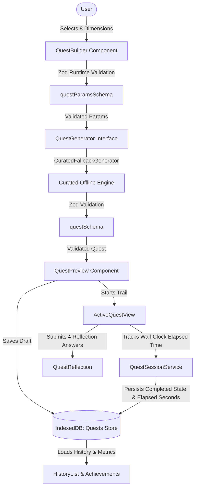

# OutsideQuest AI - System Architecture

OutsideQuest AI is a local-first, privacy-preserving web application designed to encourage people to disconnect from screen clutter and explore outdoor nature through personalized micro-adventures.

---

## 1. Architectural Philosophy

1. **Local-First & Client-Centric:** All persistent application data (quests, user settings, journal reflections) resides strictly on the user's client device within **IndexedDB**.
2. **Zero-Cloud Compute & Free Services:** No remote inference servers, paid APIs, external databases (e.g., Supabase, OpenAI, Pinecone), or secret tokens are required.
3. **Non-Blocking Execution & Modularity:** Generation is abstracted behind a clean `QuestGenerator` interface. In this stage, a deterministic `CuratedFallbackGenerator` operates 100% offline with zero network latency. In the next stage, open-weight browser Small Language Models (SLMs) integrate behind the identical interface.
4. **Resilient Offline Operation:** Full Progressive Web Application (PWA) support with service workers, local same-origin asset caching, and offline fallback screens.
5. **Restrained, Nature-Oriented Aesthetics:** Earthy color palette (`#F7F6EF`, `#315D44`, `#CBD9C7`, `#E9E0D0`, `#D88D51`, `#252B25`) with strict accessibility and reduced-motion standards.

---

## 2. Directory Structure & Layering

The codebase is organized into domain-oriented feature modules:

```text
src/
├── app/                  # Next.js App Router (Layouts, Pages, Routes, Manifest)
│   ├── history/          # My Journal (completed walks, reflections, filters, achievements)
│   ├── privacy/          # Privacy & Transparency Guarantee
│   ├── about-ai/         # On-Device AI Architecture & Compute Details
│   ├── offline/          # Offline Explorer Guide & PWA Fallback
│   ├── globals.css       # Earth-theme tokens and accessibility styles
│   └── layout.tsx        # Shell layout, semantic landmarks, header & footer
├── components/           # Reusable generic design system components
│   ├── layout/           # AppHeader, AppFooter, MobileNavigation
│   └── ui/               # Button, Card, Badge, ProgressBar, LoadingState, EmptyState, ErrorMessage
├── features/             # Business capability slices
│   ├── quest-builder/    # Form components, Zod schemas, validation, builder hooks
│   │   ├── schemas/      # questParamsSchema (8 form fields), questSchema (full runtime validation)
│   │   ├── services/     # QuestGenerator interface & CuratedFallbackGenerator implementation
│   │   ├── hooks/        # useQuestBuilder
│   │   └── components/   # QuestBuilder, QuestPreview
│   ├── quest-session/    # Active trail runner, milestone checklists, session hooks
│   │   ├── services/     # QuestSessionService (wall-clock persistence & pause tracking)
│   │   ├── hooks/        # useQuestSession
│   │   └── components/   # ActiveQuestView (focus step, timer, reflection submission)
│   ├── ai/               # AI Engine service, Web Worker, prompt templates, hardware detector
│   │   ├── services/     # aiEngine
│   │   ├── workers/      # worker.ts (WebGPU/WASM thread)
│   │   └── components/   # LocalAiStatus (truthful engine status)
│   ├── history/          # Journal records, filters, metrics & recent activity
│   │   ├── services/     # HistoryService
│   │   ├── hooks/        # useQuestHistory
│   │   └── components/   # HistoryList, RecentActivitySection
│   └── achievements/     # Real computed nature badges from local quest records
│       ├── services/     # AchievementService (transparent, non-fabricated metrics)
│       └── components/   # AchievementBadge
├── lib/                  # Shared foundations
│   ├── storage/          # IndexedDB abstraction, QuestRepository, SettingsRepository
│   ├── constants.ts      # Design tokens, UI options, safety rules & model metadata
│   └── utils.ts          # Formatting, class merging (cn), unique ID generation
└── types/                # Strict domain TypeScript definitions
```

---

## 3. Data Flow & State Management



---

## 4. Progressive Web App (PWA) & Offline Strategy

- **Service Worker (`public/sw.js`):** Pre-caches application shell, icons, manifest, and `public/offline.html`. Evicts stale caches on activate and restricts caching to same-origin resources.
- **Manifest (`src/app/manifest.ts`):** Defines standalone mobile launch properties, theme color `#315D44`, and background color `#F7F6EF`.
- **Zero-Network Functionality:** Quests generate, execute, and persist 100% offline without network connectivity.
